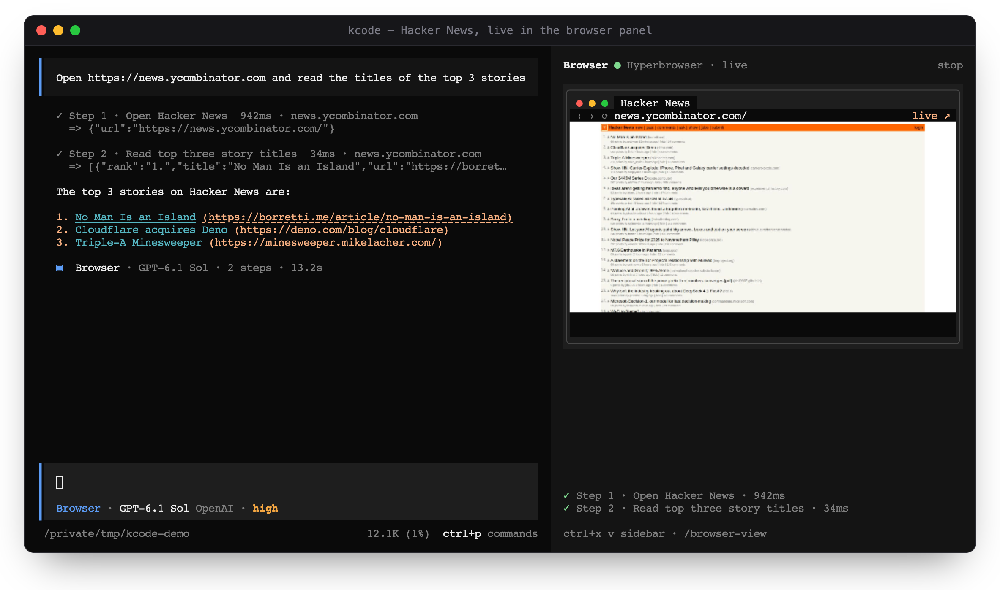

<div align="center">

<a href="https://kcode.outhad.com"></a>

<h3>Describe a web task from your terminal.<br>KoraCode drives a real browser, step by step, in view.</h3>

<p>
  <a href="https://github.com/tanzil7890/kcode-releases/releases/latest"></a>
  
  <a href="https://kcode.outhad.com/docs/"></a>
  <a href="LICENSE"></a>
</p>

<p>
  <a href="https://kcode.outhad.com"><b>Website</b></a> ·
  <a href="https://kcode.outhad.com/docs/"><b>Docs</b></a> ·
  <a href="https://github.com/tanzil7890/kcode-releases/releases"><b>Releases</b></a> ·
  <a href="https://github.com/tanzil7890/kcode-releases/issues/new?template=bug-report.yml"><b>Report a bug</b></a>
</p>

</div>

## Install

```sh
curl -fsSL https://kcode.outhad.com/install | bash
```

This installs `kcode` to `~/.kcode/bin` on macOS, Linux, and Windows (Git Bash). Open a new terminal and run
`kcode`.

> [!TIP]
> On a Mac, run KoraCode in [iTerm2](https://iterm2.com/downloads.html): the live browser view is sharpest there.
> VS Code's terminal works too with `"terminal.integrated.enableImages": true`.

## Watch it work

<p align="center">
  
</p>

You type the task. The agent works in a real browser, each step shows up in plain words, and the page it is on
streams into a panel next to the chat.

<table>
  <tr>
    <td width="50%" valign="top">
      <b>A real browser</b><br>
      Your own Chrome with your logins, a fresh isolated Chrome, or a cloud browser: Anchor, Browserbase,
      Hyperbrowser, Steel, or Kernel.
    </td>
    <td width="50%" valign="top">
      <b>Live, in your terminal</b><br>
      Watch the page the agent is driving, with its title, URL, and every step as it happens.
    </td>
  </tr>
  <tr>
    <td width="50%" valign="top">
      <b>Asks before it acts</b><br>
      It checks with you before purchases, sending messages, deleting data, or changing account settings.
    </td>
    <td width="50%" valign="top">
      <b>Your model</b><br>
      OpenAI, Anthropic, Google Gemini, xAI, OpenRouter, or DeepSeek. Bring your own key.
    </td>
  </tr>
</table>

## Quick start

1. **Install** with the command above, then run `kcode` in a new terminal.
2. **Add a model:** run `/connect` and paste an API key.
3. **Ask for something:**

   ```text
   Find the top 5 stories on Hacker News with their links
   ```

   The agent connects to your Chrome, or to a cloud browser once you pick one with `/browser`
   ([how browsers connect](https://kcode.outhad.com/docs/#connect-browser)).

Prefer a script? `kcode run "…"` runs a task headlessly and prints the result.

## Downloads

The install command picks the right build for you. To download one yourself, these links always point at the
latest release:

| Platform                | Download                                                                                                                                                                                                                                        |
| ----------------------- | ----------------------------------------------------------------------------------------------------------------------------------------------------------------------------------------------------------------------------------------------- |
| macOS · Apple Silicon   | [`kcode-darwin-arm64.zip`](https://github.com/tanzil7890/kcode-releases/releases/latest/download/kcode-darwin-arm64.zip)                                                                                                                        |
| macOS · Intel           | [`kcode-darwin-x64.zip`](https://github.com/tanzil7890/kcode-releases/releases/latest/download/kcode-darwin-x64.zip)                                                                                                                            |
| Linux · x64             | [`kcode-linux-x64.tar.gz`](https://github.com/tanzil7890/kcode-releases/releases/latest/download/kcode-linux-x64.tar.gz) · [musl](https://github.com/tanzil7890/kcode-releases/releases/latest/download/kcode-linux-x64-musl.tar.gz)           |
| Linux · arm64           | [`kcode-linux-arm64.tar.gz`](https://github.com/tanzil7890/kcode-releases/releases/latest/download/kcode-linux-arm64.tar.gz) · [musl](https://github.com/tanzil7890/kcode-releases/releases/latest/download/kcode-linux-arm64-musl.tar.gz)     |
| Windows · x64           | [`kcode-windows-x64.zip`](https://github.com/tanzil7890/kcode-releases/releases/latest/download/kcode-windows-x64.zip)                                                                                                                          |
| Windows · arm64         | [`kcode-windows-arm64.zip`](https://github.com/tanzil7890/kcode-releases/releases/latest/download/kcode-windows-arm64.zip)                                                                                                                      |
| Headless server (Linux) | `curl -fsSL https://kcode.outhad.com/bytecode \| sh`                                                                                                                                                                                            |

Older x64 CPUs without AVX2 use the `-baseline` builds on the [Releases](https://github.com/tanzil7890/kcode-releases/releases)
page.

**Pin a version, upgrade, or remove:**

```sh
curl -fsSL https://kcode.outhad.com/install | bash -s -- --version 0.3.16
kcode upgrade
kcode uninstall
```

## Documentation

Everything else is at **[kcode.outhad.com/docs](https://kcode.outhad.com/docs/)**:
[connect a model](https://kcode.outhad.com/docs/#connect-model) ·
[connect a browser](https://kcode.outhad.com/docs/#connect-browser) ·
[cloud browsers](https://kcode.outhad.com/docs/#cloud-browsers) ·
[watch it live](https://kcode.outhad.com/docs/#watch-live) ·
[configuration](https://kcode.outhad.com/docs/#configuration)

## License

MIT, see [LICENSE](LICENSE).
